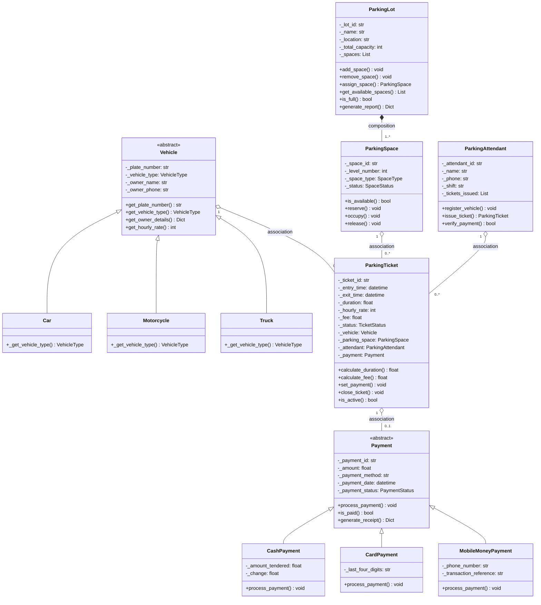

# Parking Management System

A complete, object-oriented Parking Management System implemented in Python 3.10+, demonstrating key OOP principles: encapsulation, inheritance, polymorphism, abstraction, composition, and association.

## Features

- Register vehicles (cars, motorcycles, trucks)
- Assign parking spaces based on vehicle type
- Issue parking tickets with entry time tracking
- Calculate parking fees with hourly rates
- Process payments via cash, card, or mobile money
- Track payment status and generate receipts
- Exit vehicles and release parking spaces
- Generate comprehensive availability reports

## Installation

1. Clone or download this repository
2. Navigate to the project directory:
   ```bash
   cd "Parking Mnagament System"
   ```
3. Install dependencies (optional, for development):
   ```bash
   pip install -e ".[dev]"
   ```

## Running the System

### Interactive CLI Demo

Run the interactive menu-driven interface:

```bash
python main.py
```

The CLI provides options to:
- Register a vehicle and issue a ticket
- Process payment and exit
- View availability report
- List active tickets
- Quit

### Scripted Demo

Run the non-interactive scripted walkthrough:

```bash
python demo.py
```

This demo creates a parking lot, parks multiple vehicles, processes all three payment types, and prints reports.

## Running Tests

Run the pytest test suite:

```bash
python -m pytest
```

Or use the convenience batch file:

```bash
.\pytest.bat
```

Run with verbose output:

```bash
python -m pytest -v
# or
.\pytest.bat -v
```

Run specific test file:

```bash
python -m pytest tests/test_vehicle.py
# or
.\pytest.bat tests/test_vehicle.py
```

## Class Diagram



## Class Table

| Class | Description | Key Responsibilities |
|-------|-------------|---------------------|
| `Vehicle` | Abstract base class for vehicles | Store vehicle info, provide hourly rate |
| `Car` | Car vehicle type | Set vehicle_type to CAR |
| `Motorcycle` | Motorcycle vehicle type | Set vehicle_type to MOTORCYCLE |
| `Truck` | Truck vehicle type | Set vehicle_type to TRUCK |
| `ParkingSpace` | Individual parking bay | Track availability, reserve/occupy/release |
| `ParkingTicket` | Record of one parking visit | Track entry/exit, calculate fees, link to vehicle/space/attendant/payment |
| `Payment` | Abstract base class for payments | Process payment, generate receipt |
| `CashPayment` | Cash payment implementation | Handle tendered amount and change |
| `CardPayment` | Card payment implementation | Handle card last four digits |
| `MobileMoneyPayment` | Mobile money payment implementation | Handle phone and transaction reference |
| `ParkingAttendant` | Staff member who manages parking | Register vehicles, issue tickets, verify payments |
| `ParkingLot` | Entire parking facility | Manage spaces, assign parking, generate reports |

## Relationships and Multiplicities

| Relationship | Type | Multiplicity | Meaning |
|--------------|------|--------------|---------|
| `ParkingLot` ◆— `ParkingSpace` | Composition | 1 to 1..* | The lot owns its spaces; every space belongs to exactly one lot |
| `ParkingSpace` — `ParkingTicket` | Association | 1 to 0..* | A space appears on many tickets over time; each ticket uses one space |
| `Vehicle` — `ParkingTicket` | Association | 1 to 0..* | One vehicle can have many visit tickets; each ticket is for one vehicle |
| `ParkingTicket` — `Payment` | Association | 1 to 0..1 | A ticket has at most one payment; unpaid tickets have none yet |
| `ParkingAttendant` — `ParkingTicket` | Association | 1 to 0..* | One attendant issues many tickets; each ticket has one attendant |
| `Vehicle` ← `Car` | Inheritance | - | Car is a Vehicle |
| `Vehicle` ← `Motorcycle` | Inheritance | - | Motorcycle is a Vehicle |
| `Vehicle` ← `Truck` | Inheritance | - | Truck is a Vehicle |
| `Payment` ← `CashPayment` | Inheritance | - | CashPayment is a Payment |
| `Payment` ← `CardPayment` | Inheritance | - | CardPayment is a Payment |
| `Payment` ← `MobileMoneyPayment` | Inheritance | - | MobileMoneyPayment is a Payment |

## Assumptions

The following assumptions are documented in `src/parking/config.py` for easy modification:

1. **Default hourly rates** (in KES - Kenyan Shillings):
   - Motorcycle: 50 KES per hour
   - Car: 100 KES per hour
   - Truck: 200 KES per hour

2. **Space types**: `MOTORCYCLE`, `CAR`, `TRUCK`
   - A vehicle can only park in a matching space type

3. **Minimum parking duration**: 1 hour
   - Duration is rounded up to the next full hour with a minimum of 1 hour
   - Fee = billable_hours × hourly_rate

4. **Time injection**: Time is injectable for testing purposes
   - Pass a `clock` or explicit `now` argument to avoid dependency on real time in tests

5. **Payment processing**: Cash, card, and mobile money payments always succeed in this implementation
   - In a real system, these would integrate with payment gateways/banks

## OOP Principles Demonstrated

- **Encapsulation**: Private attributes with `@property` getters and validation in setters
- **Inheritance**: `Vehicle` ← `Car`, `Motorcycle`, `Truck`; `Payment` ← `CashPayment`, `CardPayment`, `MobileMoneyPayment`
- **Polymorphism**: Each vehicle subclass sets its own type and rate; each payment subclass overrides `process_payment()` with its own behavior
- **Abstraction**: `Vehicle` and `Payment` are abstract base classes with `@abstractmethod` decorators
- **Composition**: `ParkingLot` owns `ParkingSpace` objects (spaces have no meaning without the lot)
- **Association**: `ParkingTicket` associates with `Vehicle`, `ParkingSpace`, `ParkingAttendant`, and `Payment`

## Project Structure

```
parking_system/
├── README.md
├── pyproject.toml
├── src/
│   └── parking/
│       ├── __init__.py
│       ├── enums.py          # SpaceStatus, SpaceType, VehicleType, TicketStatus, PaymentStatus
│       ├── exceptions.py     # LotFullError, InvalidTicketError, PaymentError, VehicleAlreadyParkedError
│       ├── vehicle.py        # Vehicle (ABC), Car, Motorcycle, Truck
│       ├── parking_space.py  # ParkingSpace
│       ├── payment.py        # Payment (ABC), CashPayment, CardPayment, MobileMoneyPayment
│       ├── parking_ticket.py # ParkingTicket
│       ├── attendant.py      # ParkingAttendant
│       ├── parking_lot.py    # ParkingLot
│       └── config.py         # hourly rates and defaults
├── main.py                   # interactive CLI demo
├── demo.py                   # non-interactive scripted walkthrough
└── tests/
    ├── test_vehicle.py
    ├── test_parking_space.py
    ├── test_ticket.py
    ├── test_payment.py
    ├── test_parking_lot.py
    └── test_full_cycle.py
```

## Code Quality

- **Type hints**: Full type hints on all methods and functions
- **Docstrings**: Docstring on every class and public method
- **PEP 8 compliant**: Follows Python style guidelines
- **No global mutable state**: All state is encapsulated in objects
- **Standard library only**: Core uses only Python standard library; `pytest` for tests

## License

This is a university course project (BIT223 – Object-Oriented Programming I) demonstrating OOP principles.
